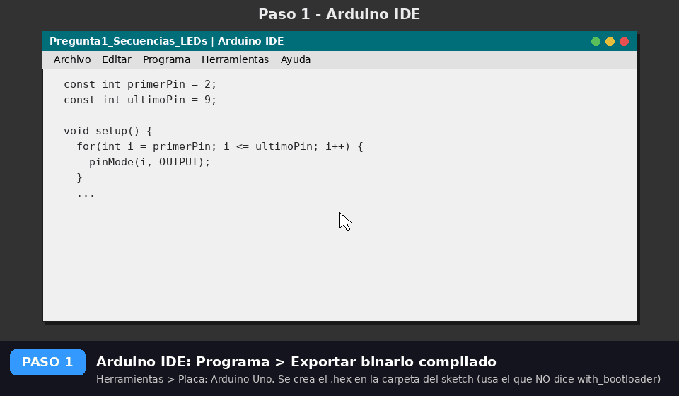
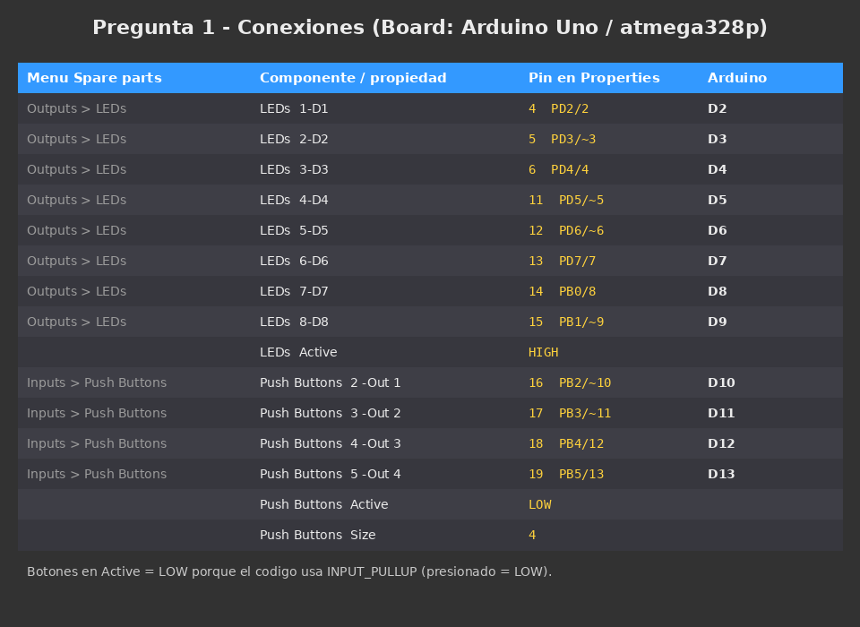
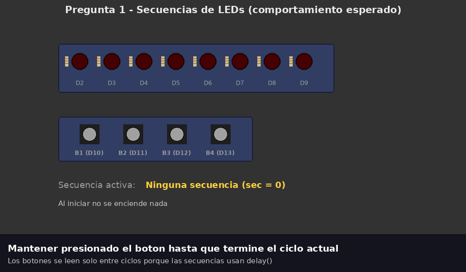
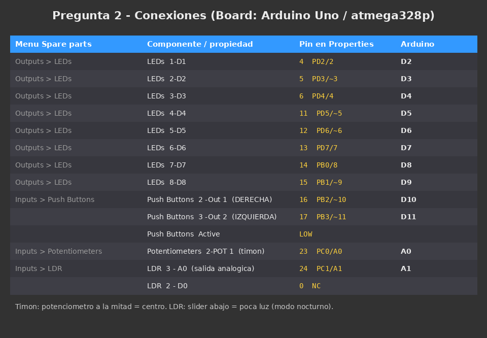
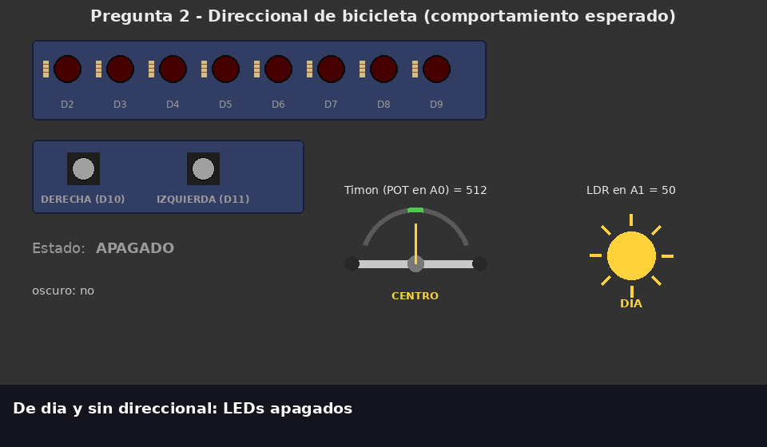
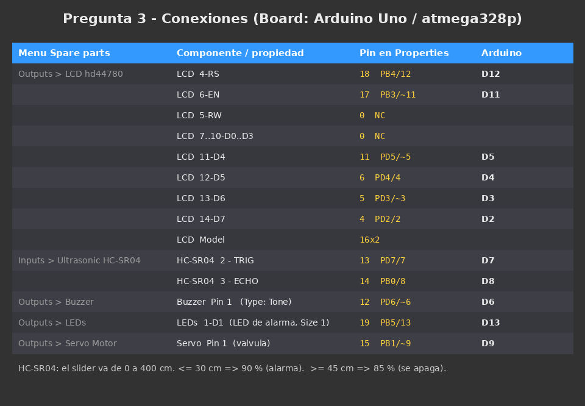
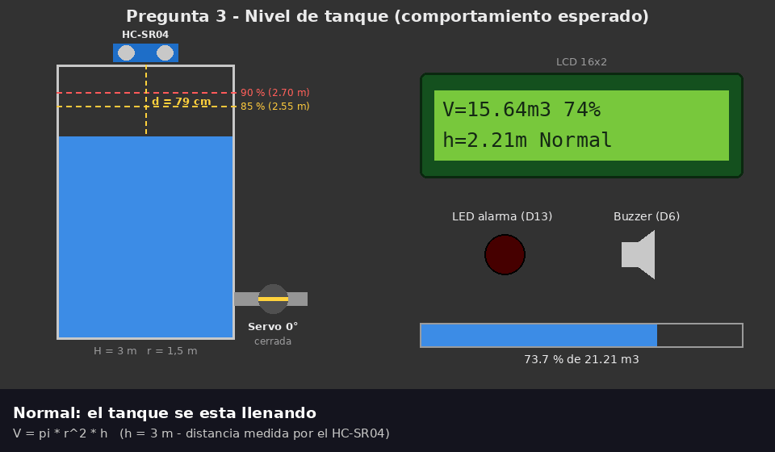

# Guía paso a paso: del Arduino IDE a PICSimLab

> Las imágenes de esta guía son **ilustraciones** que muestran los menús y el resultado esperado.
> No son capturas reales de PICSimLab. Los nombres de los menús y de los pines son los de PICSimLab 0.9.x.

---

## Opción rápida: abrir los `.pzw` ya preparados

1. Abre PICSimLab.
2. Menú **File → Load Workspace**.
3. Elige el `.pzw` de la carpeta de la pregunta, por ejemplo `Pregunta1_Secuencias_LEDs/Pregunta1_Secuencias_LEDs.pzw`.
4. Se cargan la placa (Arduino Uno), el programa y los componentes ya conectados.

Si no abre bien en tu versión, sigue la opción manual. Al final, guarda tu propio workspace con
**File → Save Workspace**.

---

## Opción manual

### Paso 1 – Exportar el `.hex` en el Arduino IDE

1. Abre el `.ino` de la pregunta.
2. **Herramientas → Placa → Arduino Uno**.
3. **Programa → Exportar binario compilado** (`Ctrl + Alt + S`).
4. En la carpeta del sketch (en el IDE 2.x, dentro de `build/arduino.avr.uno/`) aparece
   `Nombre.ino.hex`. Usa ese, **no** el que dice `with_bootloader`.
   *(Los `.hex` ya vienen en cada carpeta de este repositorio).*

### Paso 2 – Preparar la placa en PICSimLab

1. **Board → Arduino Uno**.
2. **Microcontroller → atmega328p**.
3. **File → Load Hex** y elige el `.hex`. La simulación arranca sola.
4. **Modules → Spare parts**: se abre la ventana de componentes.

### Paso 3 – Agregar y conectar componentes (ventana *Spare parts*)

- Los componentes se agregan desde los menús **Inputs** y **Outputs**:
  - **Inputs:** Push Buttons, Potentiometers, LDR, Ultrasonic HC-SR04.
  - **Outputs:** LEDs, LCD hd44780, Buzzer, Servo Motor.
- Para mover un componente: arrástralo con el mouse.
- Para conectarlo: **clic derecho sobre el componente → Properties** y elige el pin en cada lista.
- En la lista, cada pin aparece como `número  nombre`, por ejemplo `4  PD2/2`:
  - El número (4) es la patita del chip ATmega328P.
  - Lo que va después de la `/` es el pin del Arduino (D2).

| Pin Arduino | Aparece como | | Pin Arduino | Aparece como |
|---|---|---|---|---|
| D2 | `4  PD2/2` | | D9 | `15  PB1/~9` |
| D3 | `5  PD3/~3` | | D10 | `16  PB2/~10` |
| D4 | `6  PD4/4` | | D11 | `17  PB3/~11` |
| D5 | `11  PD5/~5` | | D12 | `18  PB4/12` |
| D6 | `12  PD6/~6` | | D13 | `19  PB5/13` |
| D7 | `13  PD7/7` | | A0 | `23  PC0/A0` |
| D8 | `14  PB0/8` | | A1 | `24  PC1/A1` |

### Paso 4 – Guardar el workspace

**File → Save Workspace** → `PreguntaN.pzw`. Ese archivo, junto con el `.ino`, es lo que se entrega.

---

## Pregunta 1 – Secuencias de LEDs

- **Outputs → LEDs**: LED1..LED8 → D2..D9, *Active* = HIGH.
- **Inputs → Push Buttons**:
  - Botones 1..4 → D10..D13.
  - *Active* = **LOW**, porque el código usa `INPUT_PULLUP`.
  - *Size* = 4.

Comportamiento esperado (mantén presionado cada botón hasta que termine el ciclo):

## Pregunta 2 – Direccional de bicicleta

- **Outputs → LEDs**: D2..D9. D2 es el extremo izquierdo.
- **Inputs → Push Buttons**: DERECHA → D10 e IZQUIERDA → D11, con *Active* = **LOW**.
- **Inputs → Potentiometers**: POT 1 → A0. Es el timón; a la mitad = centro.
- **Inputs → LDR**: la salida `3 - A0` del módulo → A1 del Arduino.
  - Si bajas el slider (poca luz), sube el voltaje y se activa el modo nocturno.

Cómo probarlo:
1. Pulsa DERECHA y aparece la flecha →.
2. Gira el potenciómetro a un lado y regrésalo a la mitad: la direccional se apaga sola.
3. Baja la luz del LDR: los LEDs parpadean.

## Pregunta 3 – Nivel del tanque

- **Outputs → LCD hd44780** (*Model* 16x2):
  - RS → D12, EN → D11.
  - D4 → D5, D5 → D4, D6 → D3, D7 → D2.
  - RW y D0..D3 en `0  NC`.
- **Inputs → Ultrasonic HC-SR04**: TRIG → D7, ECHO → D8.
- **Outputs → Buzzer**: Pin 1 → D6, *Type* = **Tone** (para escuchar `tone()`).
- **Outputs → LEDs** (*Size* 1): LED1 → D13 (LED de alarma).
- **Outputs → Servo Motor**: Pin 1 → D9.

Cómo probarlo con el slider del HC-SR04 (de 0 a 400 cm):

| Distancia | Nivel | Volumen | Resultado |
|---|---|---|---|
| 100 cm | 2,00 m | 14,14 m³ (67 %) | Normal |
| ≤ 30 cm | ≥ 2,70 m | ≥ 19,09 m³ (90 %) | **Alarma**: buzzer + LED + servo a 90° |
| ≥ 45 cm | ≤ 2,55 m | ≤ 18,03 m³ (85 %) | Se apaga la alarma y el servo vuelve a 0° |

---

## Problemas comunes

| Problema | Solución |
|---|---|
| Los botones no responden | Revisa *Active* = LOW. En la Pregunta 1, mantén el botón presionado hasta que termine el ciclo |
| El LCD no muestra nada | Revisa RS/EN y el orden de D4–D7 (D4 → D5, D5 → D4, D6 → D3, D7 → D2) |
| No suena el buzzer | En sus Properties, pon *Type* = Tone y activa el audio de tu PC |
| Ver los mensajes `Serial.print` | **Tools → Serial Terminal**, a 9600 baudios |
| Aviso de "versión más nueva" al abrir el `.pzw` | Es solo un aviso; si falla algo, arma el circuito a mano y guárdalo con *Save Workspace* |
